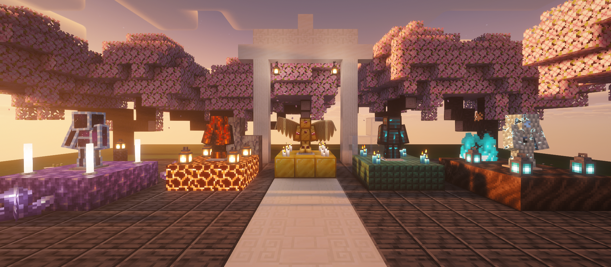
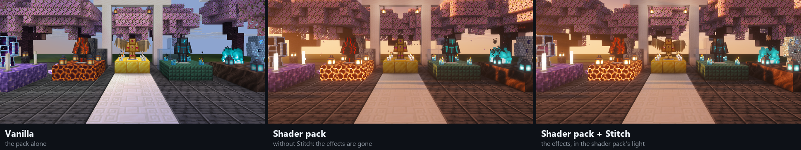
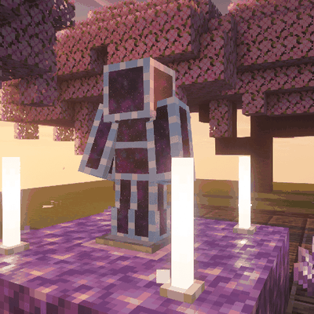
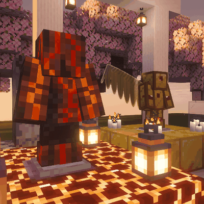
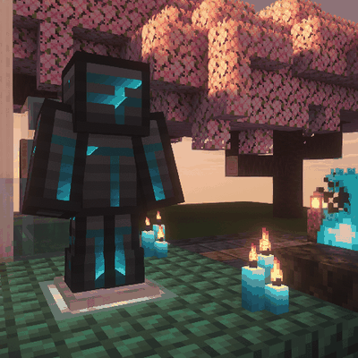
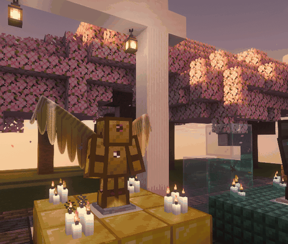
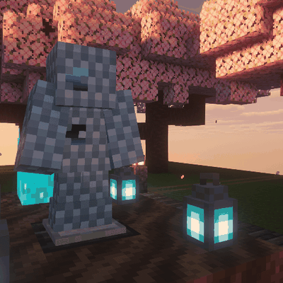
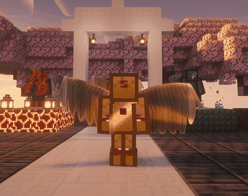

<div align="center">


# Stitch

**Resource pack shaders that keep working under shader packs.**

Write a shader effect once. It runs in vanilla, and it keeps running when the player turns on Iris or OptiFine.


[Showcase](#the-showcase-pack) · [Quick start](#quick-start) · [Features](#features) · [Where it works](#where-it-works) · [Specification](docs/SPEC.md)

</div>

<br>



<p align="center"><sub>Five armour sets from the <a href="examples/showcase/">showcase pack</a>, under the Complementary shader pack. Every effect is a resource pack stitch.</sub></p>

## Why

A resource pack can reshape how Minecraft draws things by shipping its own core shaders. Turn on a shader
pack and those shaders are thrown away: the shader pack draws the world with its own programs, and the
pack's effects vanish.



Stitch fixes that. A pack describes each effect as a **stitch**, a small GLSL function against a fixed
interface. Stitch weaves the same stitch into Minecraft's core shaders for every release when the pack
is built, and into the shader pack's programs when the game loads them.

## The showcase pack

Five armour sets in [`examples/showcase`](examples/showcase/), one stitch each, drawn over five vanilla
materials. They need nothing but the pack in vanilla, and the Stitch mod under a shader pack.

<table>
  <tr>
    <td width="33%" align="center">
      
      <p><b>Astral</b> · diamond<br><sub>Each panel is a window onto a starfield fixed in the world. The pieces float free of the body.</sub></p>
    </td>
    <td width="33%" align="center">
      
      <p><b>Magma</b> · netherite<br><sub>Lava flows down the cracks in basalt plate, embers glow beside it, and the suit shimmers with heat.</sub></p>
    </td>
    <td width="33%" align="center">
      
      <p><b>Glitch</b> · iron<br><sub>Slices tear sideways, colours split, scanlines crawl and the circuits pulse.</sub></p>
    </td>
  </tr>
  <tr>
    <td width="33%" align="center">
      
      <p><b>Seraph</b> · gold<br><sub>Great feathered wings that beat. A chestplate has no wings; the stitch folds two of its own faces out into them.</sub></p>
    </td>
    <td width="33%" align="center">
      
      <p><b>Phantom</b> · chainmail<br><sub>Spectral mail that drifts, and burns away at glowing edges as it fades in and out. Its runes pulse.</sub></p>
    </td>
    <td width="33%" align="center">
      
      <p><b>On a player</b><br><sub>Wings, shadows and all: the stitches follow the body's pose like any armour.</sub></p>
    </td>
  </tr>
</table>

The wings are the showpiece: no extra models and no mod for vanilla players. The vertex stitch takes the
chestplate's two side faces, moves each one's back edge behind the shoulder blades, and swings its front
edge out to a wing tip. The fragment stitch then draws the feathers.

## Quick start

**1. Write a stitch** under `assets/<namespace>/stitches/`: a JSON file and one or two GLSL functions.

```json
{
  "format": 1,
  "targets": ["armor"],
  "vertex": "example:stitches/glow.vert.glsl",
  "fragment": "example:stitches/glow.frag.glsl",
  "uniforms": ["game_time"],
  "requires": ["texture_size"]
}
```

```glsl
void stitch_vertex(inout StitchVertex v) {
    // move, recolour or hide the vertex
}

vec4 stitch_texel(StitchFragment f, vec4 texel) {
    // change the colour drawn
    return texel;
}
```

A target like `armor` covers everything of its kind, so a stitch checks it is looking at what it was
written for (usually a marker texel in its texture) and leaves everything else alone.

**2. Build it into the pack** with Stitch's GitHub Action:

```yaml
- uses: actions/checkout@v4
- uses: AshleyThew/stitch@v0
  with:
    pack: .
```

It fetches each Minecraft release's shaders from Mojang, weaves the stitches in, and writes them into the
pack as overlays, with their `pack.mcmeta` entries. A stitch that can't be woven fails the build.

<details>
<summary><b>Action inputs, and a <code>pack.mcmeta</code> that loads everywhere</b></summary>

| Input | Default | Meaning |
|---|---|---|
| `pack` | `.` | The pack's folder (the one with `pack.mcmeta`) |
| `versions` | `1.18.2+` | Releases to build for: a range (`1.20.5-1.21.4`), from one on (`1.20.5+`), or a list |
| `output` | the pack | Where the overlays and `pack.mcmeta` are written |
| `base` | `true` | Also write the oldest range into the pack's base folder, for releases before overlays (to 1.20.1) |
| `strict` | `true` | Fail on warnings too, such as a stitch left out of a release that can't give what it needs |

Releases up to 1.20.1 load a pack only when its `pack_format` is exactly theirs. This `pack.mcmeta` is
accepted from 1.20.1 on:

```json
{
  "pack": {
    "description": "...",
    "pack_format": 15,
    "supported_formats": {"min_inclusive": 15, "max_inclusive": 255},
    "min_format": 15,
    "max_format": 255
  }
}
```

</details>

**3. Point shader pack players at the mod.** One jar from the [latest release](https://github.com/AshleyThew/stitch/releases/latest), matching their game:

| Loader | Minecraft | Jar |
|---|---|---|
| Fabric with Iris | 1.18.2 | `stitch-fabric-1.18.jar` |
| | 1.19 to 1.21.11 | `stitch-fabric-1.19.jar` |
| | 26.1 and 26.2 | `stitch-fabric-26.1.jar` |
| | 26.3 on | `stitch-fabric-26.3.jar` |
| Forge with OptiFine | 1.18.2 | `stitch-forge-1.18.jar` |
| | 1.19 to 1.20.4 | `stitch-forge-1.19.jar` |
| | 1.20.6 to 1.21.11 | `stitch-forge-1.20.6.jar` |

The mod needs nothing from the server, and does nothing without a shader pack.

## Features

| | |
|---|---|
| ✍️ **One definition** | A stitch is written once, against an interface that doesn't change with Minecraft's shaders or a shader pack's |
| 🧱 **Every release** | Compiled into vanilla core shader overlays for every release from 1.18.2 to 26.3, version differences handled for you |
| 🌄 **Under shader packs** | Woven into Iris's and OptiFine's programs as they load, shadow pass included, so shapes cast matching shadows |
| 🔺 **Shapes, not only colours** | Move or hide vertices: flared skirts, floating plates, wings made from a chestplate's own faces |
| ⏱️ **Animation** | `game_time` in both functions, from Minecraft's clock or the shader pack's |
| 🧩 **Packs side by side** | Each stitch's names are kept private, so stitches from different packs never collide |
| 🛡️ **Fails safe** | A stitch a program can't take is left out of that program alone, with a log line saying why; the shader pack still loads |

## Where it works

| Setup | Stitches apply |
|---|---|
| Vanilla, Sodium, or Iris and OptiFine with shaders off | yes, from the pack alone |
| Fabric with Iris and a shader pack | yes, with the mod |
| Forge with OptiFine and a shader pack | yes, with the mod, wherever OptiFine runs on Forge (1.18.2 to 1.21.11) |
| OptiFine without a mod loader | no: it can't load mods |

## Documentation

- [Specification](docs/SPEC.md): every field, target, function and capability of a stitch.
- [Showcase pack](examples/showcase/): the five armour sets above.
- [Flared leggings](examples/flared-leggings/): the smallest complete example, one vertex function.
- [Blockbench armour](examples/blockbench-armor/): a winged dragon knight built from Blockbench cubes and worn as armour (a
  prototype of model stitches, for 1.18.2 and 1.21.4).

<details>
<summary><b>Building from source</b></summary>

```
./gradlew :core:test
./gradlew :compiler:jar                                     the compiler the action runs
./gradlew :fabric:legacy:remapJar -Pstitch.fabric=1.18      Fabric 1.18.2
./gradlew :fabric:legacy:remapJar -Pstitch.fabric=1.19      Fabric 1.19 to 1.21.11
./gradlew :fabric:modern:jar -Pstitch.fabric=26.1 -Pstitch.minecraftJar=<26.1 client jar>
./gradlew :fabric:modern:jar -Pstitch.fabric=26.3 -Pstitch.minecraftJar=<26.3 client jar>
./gradlew :forge:legacy:reobfJar -Pstitch.forge=1.18        Forge 1.18.2
./gradlew :forge:legacy:reobfJar -Pstitch.forge=1.19        Forge 1.19 to 1.20.4
./gradlew :forge:modern:jar -Pstitch.minecraftJar=<26.1 client jar>
```

Dependencies are pinned by checksum in `gradle/verification-metadata.xml`; a download that doesn't match
fails the build.

</details>

## Licence

[PolyForm Noncommercial 1.0.0](LICENSE.md): free for any noncommercial use.
