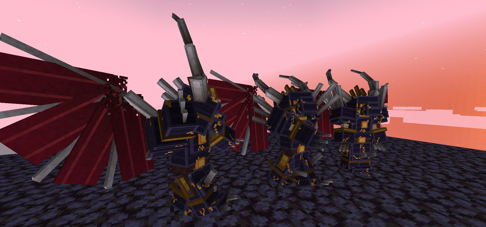
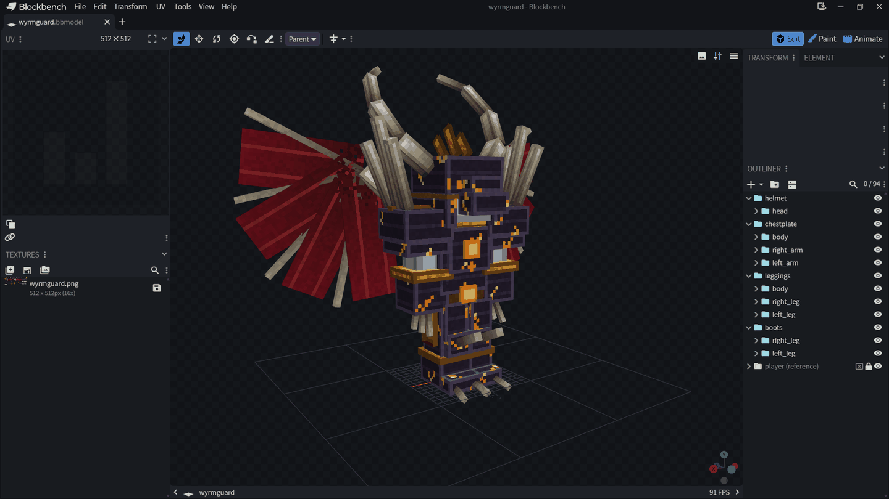
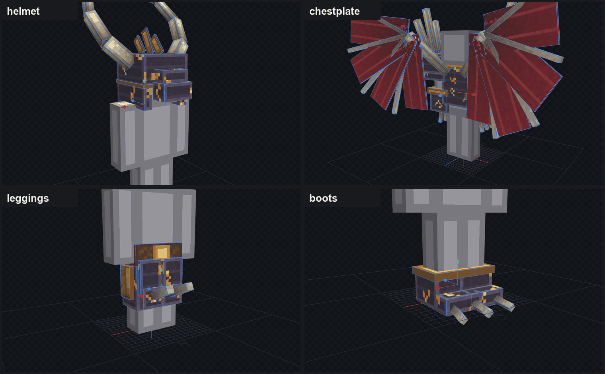
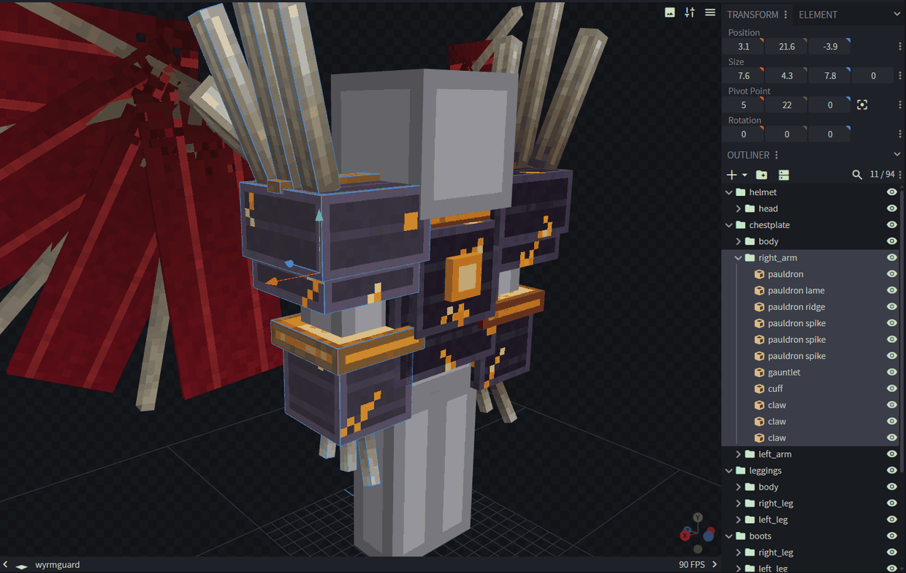
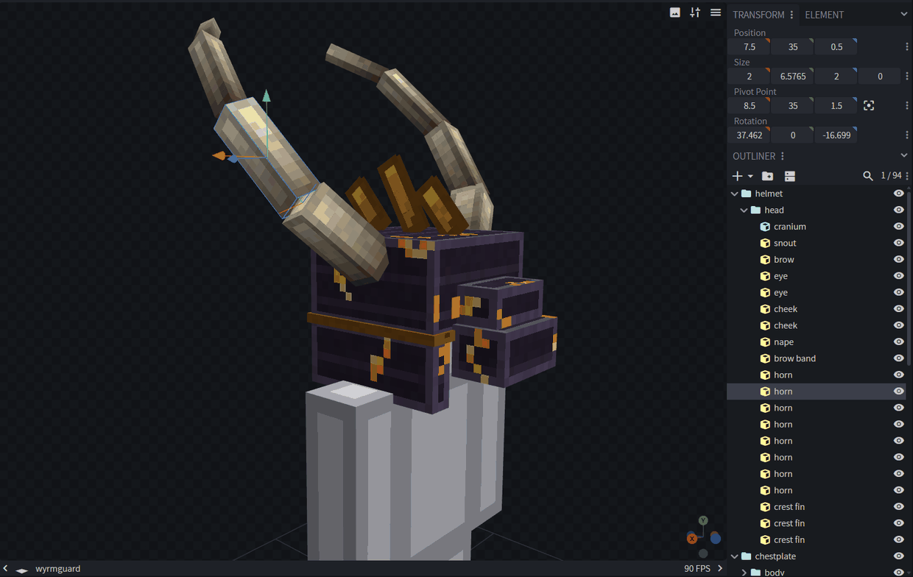
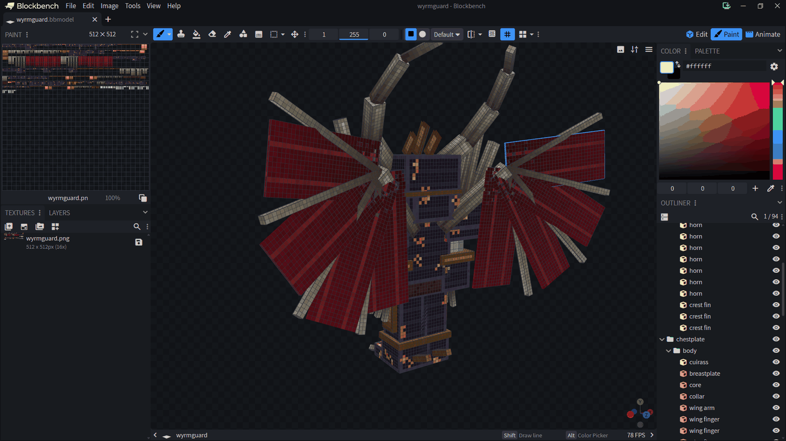
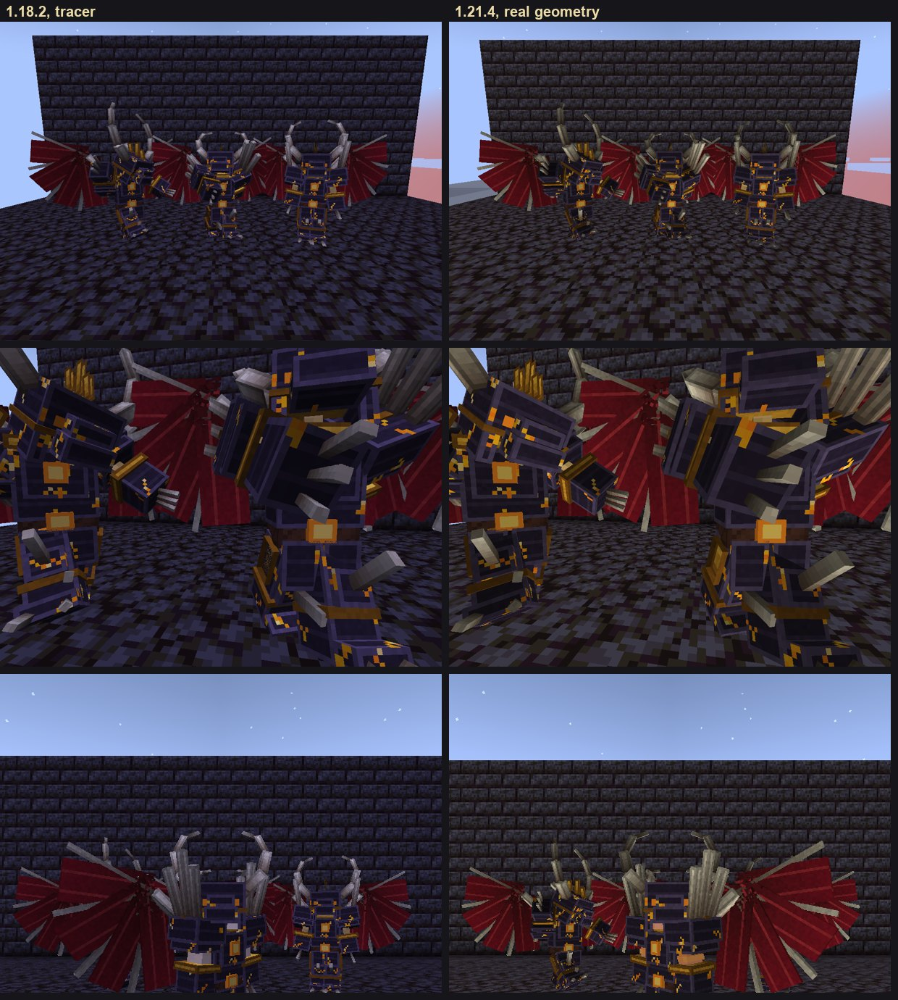
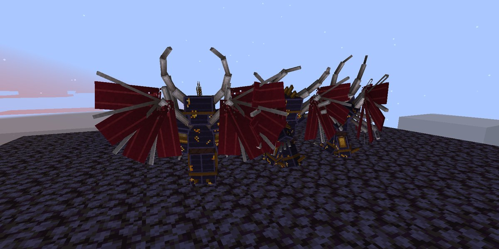

# Example: 3D armour from Blockbench



**Wyrmguard**, a dragon knight built from 94 cubes in Blockbench and worn as netherite armour. It has
a horned skull helm, wings with bone fingers and torn membranes, spiked pauldrons, clawed gauntlets
and clawed boots. Every cube follows the limb it's on. It's a resource pack only: no mods and no
extra entities.

This example is plain core shaders and a build script, not yet a stitch. It's the prototype for
model stitches, which will build the same thing from a `.bbmodel` with the Stitch action, for every
release.

```
wyrmguard.bbmodel     the model: four armour pieces of cubes, one texture, a reference player
build.py              turns a .bbmodel into the pack
shaders/1.18.2/       the ray tracer, for 1.18.2 to 1.21.1
shaders/1.21.4/       real geometry for 1.21.4, with the tracer as its fallback
images/               the pictures in this README
```

## Build it

Needs Python 3.8 or later and Pillow (`pip install pillow`).

```
python build.py wyrmguard.bbmodel build/wyrmguard --material netherite
```

That writes `build/wyrmguard/` and `build/wyrmguard.zip`. Load the zip in Minecraft 1.18.2 or 1.21.4
and wear netherite armour, or put it on an armour stand. `--material` puts the model on any armour
material (`leather`, `chainmail`, `iron`, `gold`, `diamond`, `netherite`).

## Building a set in Blockbench

The pictures are from Blockbench 5.1.6 with `wyrmguard.bbmodel` open. Any Blockbench format with cubes
works; "Generic Model" is the simplest.

### The project



Build the armour around a player standing at the origin, facing north (the model's front is towards
negative Z). The **player (reference)** folder is that player: plain boxes where Minecraft draws the
body, locked, and not exported (its export toggle is off), so it's there to build around but never
ends up in the pack. Copy it into a new project to start a set.

### Pieces are folders



The top-level folders are the four armour pieces: **helmet**, **chestplate**, **leggings** and
**boots**. Each piece draws only while that item is worn, so a player in just the boots shows just
the boots. Leave a piece out and it's invisible when worn.

### Body parts are groups, with Minecraft's pivots



Inside each piece, cubes go in groups named after the body part they move with: **head**, **body**,
**right_arm**, **left_arm**, **right_leg**, **left_leg**. Set each group's pivot point to Minecraft's:

| Group | Pivot point |
|---|---|
| `head`, `body` | `0 24 0` |
| `right_arm` | `5 22 0` |
| `left_arm` | `-5 22 0` |
| `right_leg` | `1.9 12 0` |
| `left_leg` | `-1.9 12 0` |

The chestplate and the leggings each have a `body` group: both move with the body, but each draws
with its own item. Groups inside these groups are fine (for example a `wing` group inside `body`); a
cube belongs to the nearest body part above it.

### Cubes can be rotated



Rotate cubes freely, on any axis, and rotate the groups they sit in. The horns, wing bones and spikes
are each a chain of rotated cubes. Every cube has to stay within 32 pixels of its body part's pivot;
the build stops and names the part if one doesn't.

### Texturing, and faces that cost nothing



Use any UV layout (per face or box UV) and as many textures as you like; save them into the project.
Transparent pixels cut holes, which is how the membranes are torn at their tips.

A face set to no texture isn't drawn and costs nothing. The thin membranes only have their two big
faces; the spikes and bones have no face where they meet the armour.

### Budget

Each armour box has six faces (the head twelve: it has a hat box too), and one equipment layer
redraws them all, so a piece needs as many layers as its busiest body part has visible faces divided
by six. More layers cost more to draw. Wyrmguard's helmet and chestplate need 12 layers (the wings fill
the body); its leggings need 4. Keep a set at 12 or fewer.

## In game





## How it works

Minecraft draws armour as a few boxes around the body, and a resource pack can't add more. So the
boxes' faces are made to draw the model instead, in one of two ways.

**1.21.4: real geometry.** Each armour face becomes one face of one cube.
- Every armour face's four corners run side by side on the graphics card, so each corner can read
  the others' positions (subgroup operations). The face's corners and their texture positions give
  the limb's exact transform, and the vertex shader places the cube face with it.
- One armour draw has only a few faces, so the material's equipment asset lists as many layers as
  the model needs. All of them use the same texture, so they draw in one batch; each layer's tint
  tells the shader which one it is.
- The fragment shader is Minecraft's own. For comparison, 32 armour stands in a smaller 39-cube set
  filling a 1080p screen cost about 0.2 ms a frame on an RTX 3070.

**1.18.2 to 1.21.1, and the fallback: ray tracing.** Without subgroups (macOS, older drivers), and
before equipment layers exist, the faces can't become geometry. Instead:
- One face of each armour box becomes a card facing the camera, wide enough to cover its body part.
- The fragment shader recovers the limb's transform from how the face's original position and its
  place on the box change across the screen (screen space derivatives).
- It casts a ray into the limb's own space, tests the part's cubes (as triangles, in small groups
  behind bounding boxes), samples the model's texture at the hit, and writes the hit's real depth.

The tracer works on every version, but it costs per pixel: little from a distance, around 9 ms a frame
when armour fills a 1080p screen. Treat it as the compatibility path, not the main one.

## Data layout

Each armour texture carries the model as pixels, with its own texture copied in below.

| Where | What |
|---|---|
| top right texel | the mark: `(255, 1, 255)` humanoid armour, `(255, 2, 255)` leggings |
| texel left of it (1.21.4) | the row the tracer's data starts on |
| rows 0 up (1.21.4) | one row a layer: ten texels a body part's face (`(slot * 6 + face) * 10`): four corners, the normal, four UVs, used |
| tracer rows 0 to 5 | a header row a body part: group count, card sphere, part box, then each group's range and box |
| tracer row 8 on | eight texels a triangle: three corners, three UVs, the normal |
| below | the model's textures |

Positions are a byte an axis, a quarter of a pixel; UVs a quarter of a pixel, 12 bits each.

## Limits

- Minecraft 1.18.2 to 1.21.1 and 1.21.4 only. Model stitches will cover every release.
- The tracer is expensive up close in a crowd.
- Animations (Blockbench keyframes) aren't supported yet.
- Not tested on macOS, or under shader packs.
