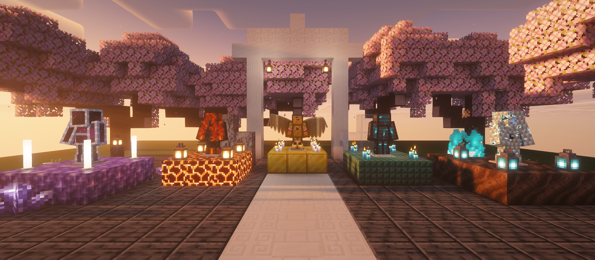
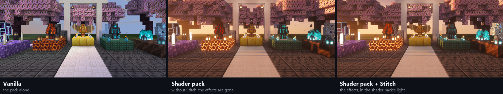

**Resource pack shaders that keep working under shader packs.**

A resource pack can change how Minecraft draws things by shipping its own shaders: glowing armour,
animated textures, shapes that move. Turn on a shader pack and those effects disappear, because the
shader pack draws the world with its own programs.

**Stitch brings them back.** Packs that use Stitch describe each effect once, and this mod weaves it
into Iris's or OptiFine's shader pack programs as they load, shadows included. Install it, keep your
shader pack, and the pack's effects stay.

## Install

Put the jar in your `mods` folder, beside your shader mod:

| Loader | Shader mod | Minecraft |
|---|---|---|
| Fabric | Iris | 1.18.2 to 26.3 |
| Forge | OptiFine | 1.18.2 to 1.21.11, wherever OptiFine runs on Forge |

- One jar covers every loader and version above.
- It does nothing without a shader pack: in vanilla, or with shaders off, the pack works on its own.
- Client only. Servers don't need it and don't check for it.
- No other mods are needed (no Fabric API).

## What you get

- **Effects under shader packs:** colour, glow and animation from the resource pack, inside the shader
  pack's own lighting.
- **Shapes too:** packs can move or hide parts of a model (flared skirts, floating plates, wings made
  from a chestplate), with shadows that match.
- **More than armour:** items in the world (in hands, item frames and on armour stands) and text in the
  world, such as a pack's minimap drawn from maps in item frames, keep their effects too.
- **Safe to leave on:** an effect a shader pack can't take is skipped for that program alone, with a log
  line saying why. The shader pack always loads.

## For pack makers

Stitches are written once in GLSL against a fixed interface, and a GitHub Action builds them into the
pack for every release from 1.18.2. The [specification, examples and the Action](https://github.com/AshleyThew/stitch)
are on GitHub.

[Source](https://github.com/AshleyThew/stitch) · [Issues](https://github.com/AshleyThew/stitch/issues) ·
Licence: [PolyForm Noncommercial 1.0.0](https://github.com/AshleyThew/stitch/blob/main/LICENSE.md)
